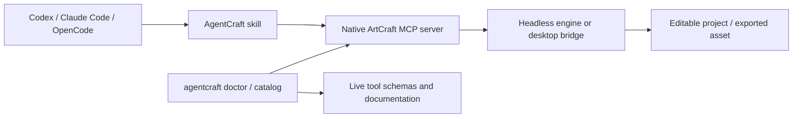

# AgentCraft MCP Suite

**Use the 13 Storytold ArtCraft creative applications from Codex, Claude Code, and OpenCode through their native MCP servers.**

One installer. Fourteen reusable Agent Skills (13 specialists + an orchestrator). A CLI to inspect live MCP endpoints and export their schemas. No unofficial endpoints, invented commands, or bundled application binaries.

> [!IMPORTANT]
> **Release 0.1.1 — integration foundation, not a fully certified ArtCraft automation suite.** The installer, MCP discovery, schema export, and mock-server tests run successfully. End-to-end editing and rendering **have not** been tested against all 13 real ArtCraft builds. Each upstream application remains independently versioned; inspect the schemas returned by the binary you installed.

**[Quick start](#quick-start)** · **[Português](docs/quickstart-pt-BR.md)** · **[Applications](#supported-applications)** · **[Client integration](#integrate-with-your-agent)** · **[MCP reference](#discover-every-supported-mcp-endpoint)** · **[Security](#security-model)** · **[Troubleshooting](#troubleshooting)**

## How it works



AgentCraft is **not a replacement editor** and does not implement third-party MCP tools. It installs skill instructions and registers the upstream `*-cli mcp` executable for each selected app. The agent discovers available commands and drives the real editor. Use the desktop bridge when you need to observe work in the UI; use headless for unattended production where supported.

## Quick start

**Requirements:** Python 3.11+, an installed Codex/Claude Code/OpenCode client, and **at least one actual ArtCraft `*-cli` executable** from an [upstream release](https://getartcraft.com/apps) or upstream Rust build. Installing this Python package does **not** install the ArtCraft applications.

### 1. Install AgentCraft

```bash
# Clone after publishing the repository (or unpack the provided source archive)
git clone https://github.com/venysssssssssss/agentcraft-mcp-suite.git
cd agentcraft-mcp-suite
python -m pip install -e .
agentcraft --version
```

### 2. Register your apps in a working project

```bash
# Linux / macOS / WSL: adapt these paths to your machine.
agentcraft install \
  --scope project \
  --target /path/to/your-workspace \
  --apps effectcraft,filmcraft,vectorcraft \
  --client all
```

`--apps all` installs skills for all 13, but only registers MCP servers for **detected** binaries. `--strict` fails when an app is missing instead of silently skipping its MCP registration.

If executables are not on `PATH`, use `--bin-dir /path/to/cli-directory` if they are together, or define per-app variables such as `AGENTCRAFT_EFFECTCRAFT_CLI=/absolute/path/to/effectcraft-cli`. On Windows use the full `.exe` path.

For **PowerShell**, the same command on one line:

```powershell
agentcraft install --scope project --target C:\Dev\my-project --apps effectcraft,filmcraft,vectorcraft --client all
```

If you run agents in **WSL2**, use Linux-native ArtCraft binaries inside WSL. Installing an `.exe` on Windows does not make its GUI, file paths, sockets, or MCP subprocess lifecycle equivalent to a native WSL process. Run the agent and its MCP binary in the **same OS environment** whenever possible.

### 3. Validate the connection and load commands

```bash
agentcraft doctor --apps effectcraft,filmcraft,vectorcraft
agentcraft catalog --apps effectcraft,filmcraft,vectorcraft --engine --out docs/generated
```

Restart your agent client to pick up the newly installed skills and MCP definitions. The `doctor` command is a **live MCP handshake and discovery test**, not a rendering or functional acceptance test.

## Integrate with your agent

The installer writes the corresponding skill and MCP config to your **target workspace**. Existing JSON/TOML configuration is preserved where supported; inspect the generated changes before committing them to a shared repository.

| Agent client | Project skill location | MCP configuration | Invoke |
|---|---|---|---|
| **Codex** | `.agents/skills/agentcraft-effectcraft/SKILL.md` | `.codex/config.toml` | `$agentcraft-effectcraft` |
| **Claude Code** | `.claude/skills/agentcraft-effectcraft/SKILL.md` | `.mcp.json` | `/agentcraft-effectcraft` |
| **OpenCode** | `.opencode/skills/agentcraft-effectcraft/SKILL.md` | `opencode.json` | `/agentcraft-effectcraft` |

OpenCode also receives an explicit command file under `.opencode/commands`. Claude Code receives `.claude/commands`. `agentcraft` is the general-purpose router skill. See the [official Codex MCP documentation](https://developers.openai.com/codex/mcp), [Claude Code MCP documentation](https://code.claude.com/docs/en/mcp), [OpenCode MCP documentation](https://docs.opencode.ai/docs/mcp-servers/), and [OpenCode skills documentation](https://docs.opencode.ai/docs/skills/).

### MCP configuration examples

For **OpenCode**, generated `opencode.json` uses the documented `mcp.<name>` structure, with a **flat** `command` array and timeout in milliseconds:

```json
{
  "$schema": "https://opencode.ai/config.json",
  "mcp": {
    "effectcraft": {
      "type": "local",
      "command": ["/absolute/path/to/effectcraft-cli", "mcp"],
      "enabled": true,
      "timeout": 30000
    }
  }
}
```

For **Claude Code**, `.mcp.json` uses:

```json
{
  "mcpServers": {
    "effectcraft": {
      "command": "/absolute/path/to/effectcraft-cli",
      "args": ["mcp"]
    }
  }
}
```

For **Codex**, `.codex/config.toml` uses:

```toml
[mcp_servers.effectcraft]
command = "/absolute/path/to/effectcraft-cli"
args = ["mcp"]
startup_timeout_sec = 30
tool_timeout_sec = 120
```

Replace the example path with the **detected path on your machine**. You ordinarily do **not** need to edit these configurations manually: `agentcraft install` generates them.

### Example agent requests

```text
/agentcraft-effectcraft Create a 6-second 1920x1080 kinetic typography intro,
preview frames, then render the deliverable. Report the output path and verification.
```

```text
/agentcraft-vectorcraft Design a vector illustration. Export the native project
and SVG; inspect the output for clipping and text legibility.
```

```text
$agentcraft Plan a cross-app workflow: vector illustration → motion composition
→ video editing. Check the MCP tools and interchange formats before execution.
```

The third example uses Codex's `$` invocation. Requests are **examples**, not guaranteed capabilities; engine commands, encoders and output formats are determined by your installed versions.

## Supported applications

| Skill / MCP server | Primary workflow | Authoritative upstream documentation |
|---|---|---|
| [`photocraft`](skills/agentcraft-photocraft/SKILL.md) | Raster editing, layers, compositing | [PhotoCraft MCP](https://github.com/storytold/photocraft/blob/main/docs/mcp.md) |
| [`vectorcraft`](skills/agentcraft-vectorcraft/SKILL.md) | Vector paths, illustration, SVG | [VectorCraft MCP](https://github.com/storytold/vectorcraft/blob/main/docs/mcp.md) |
| [`filmcraft`](skills/agentcraft-filmcraft/SKILL.md) | Timeline, video editing and output | [FilmCraft agents](https://github.com/storytold/filmcraft/blob/main/docs/agents.md) |
| [`lightcraft`](skills/agentcraft-lightcraft/SKILL.md) | Photography, RAW and grading | [LightCraft MCP](https://github.com/storytold/lightcraft/blob/main/docs/mcp.md) |
| [`pdfcraft`](skills/agentcraft-pdfcraft/SKILL.md) | PDF reading and manipulation | [PdfCraft MCP](https://github.com/storytold/pdfcraft/blob/main/docs/mcp.md) |
| [`effectcraft`](skills/agentcraft-effectcraft/SKILL.md) | Motion graphics and effects | [EffectCraft agents](https://github.com/storytold/effectcraft/blob/main/docs/agents.md) · [MCP](https://github.com/storytold/effectcraft/blob/main/docs/mcp.md) |
| [`designcraft`](skills/agentcraft-designcraft/SKILL.md) | Page and publication design | [DesignCraft MCP](https://github.com/storytold/designcraft/blob/main/docs/mcp.md) |
| [`figcraft`](skills/agentcraft-figcraft/SKILL.md) | UI mockups and product interfaces | [FigCraft MCP](https://github.com/storytold/figcraft/blob/main/docs/mcp.md) |
| [`wordcraft`](skills/agentcraft-wordcraft/SKILL.md) | Rich-text documents | [WordCraft MCP](https://github.com/storytold/wordcraft/blob/main/docs/mcp.md) |
| [`soundcraft`](skills/agentcraft-soundcraft/SKILL.md) | Multitrack audio and MIDI | [SoundCraft MCP](https://github.com/storytold/soundcraft/blob/main/docs/mcp.md) |
| [`deckcraft`](skills/agentcraft-deckcraft/SKILL.md) | Presentation slides | [DeckCraft MCP](https://github.com/storytold/deckcraft/blob/main/docs/mcp.md) |
| [`cadcraft`](skills/agentcraft-cadcraft/SKILL.md) | 2D technical drawing | [CADCraft MCP](https://github.com/storytold/cadcraft/blob/main/docs/mcp.md) |
| [`gridcraft`](skills/agentcraft-gridcraft/SKILL.md) | Spreadsheet models and charts | [GridCraft MCP](https://github.com/storytold/gridcraft/blob/main/docs/mcp.md) |

**Names:** Skill IDs are `agentcraft-<app>`, while MCP server IDs are `<app>`. The additional `agentcraft` orchestrator is a skill, not a fourteenth MCP server.

### Headless vs. desktop control

All 13 upstream projects document headless MCP entrypoints. GUI bridge flags are application-specific:

| Native bridge flag | Applications |
|---|---|
| `--bridge` | PhotoCraft, FilmCraft, EffectCraft |
| `--connect` | VectorCraft, LightCraft, DesignCraft, WordCraft, SoundCraft, DeckCraft, CADCraft, GridCraft |
| `--attach` | FigCraft |
| No documented desktop bridge in AgentCraft registry | PdfCraft |

Example of desktop-mode registration, **after** launching the application's GUI with its control port:

```bash
agentcraft install --target /path/to/project --apps effectcraft --client all --mode desktop
```

PhotoCraft requires an additional `--photocraft-token-file` matching the desktop app's control-token file. Desktop bridges may fail unless their GUI is running; they should not be exposed over public network interfaces. See upstream docs before using live control.

## Discover every supported MCP endpoint

Never hard-code presumed MCP tool names or command IDs. Some upstream servers expose generic tools such as `command_list` and `command_run` that in turn expose a **separate internal engine-command catalog**.

```bash
# Runtime MCP endpoints: complete returned JSON schemas, annotations,
# resources/templates and prompts (where implemented).
agentcraft catalog --apps all --out docs/generated

# Also request internal engine commands when upstream exposes discovery.
agentcraft catalog --apps effectcraft --engine --out docs/generated
```

Output: `docs/generated/effectcraft.md` (readable reference) and `effectcraft.json` (machine-readable snapshot), with equivalent files for every responding app. A catalog is specific to the **currently installed version, operating mode, and document state**; rerun it after upgrading the apps.

For direct one-off inspection:

```bash
agentcraft call effectcraft command_list --arguments '{}'
# Only after explicit review of a mutating tool and engine ID:
agentcraft call effectcraft command_run \
  --arguments '{"id":"<id-from-current-command-list>","params":{}}' --allow-write
```

The placeholder ID is intentional; substitute a real ID discovered from your running engine. `call` starts a **fresh MCP process** for each invocation. Use the native MCP connection in your agent for editing that depends on an ongoing in-memory session. Detailed design: [architecture](docs/architecture.md).

## Security model

- **OS authority:** Native MCP servers inherit the privileges of the process running them; they can read/write files according to upstream behavior. A skill is not a sandbox.
- **Scoped filesystem:** For upstream builds with verified `--automation-read-root` / `--automation-write-root`, enable `--file-scope workspace` in **project** scope. Coverage varies; certain scripting/GUI capabilities are deliberately unavailable in confined mode.
- **Mutating operations:** `agentcraft call` requires `--allow-write` when `annotations.readOnlyHint` is not explicitly true; the agent's native MCP connection still uses its own authorization controls.
- **Secrets:** Do not commit `.mcp.json` containing private tokens, generated agent configuration, credentials or exported client data. Keep GUI control channels on loopback.
- **Source integrity:** Download ArtCraft binaries from upstream and verify platform signatures/checksums when provided. This repository includes original integration code and prompts only.

## Troubleshooting

| Symptom | Action |
|---|---|
| `*-cli not found` | Install/build the upstream CLI, add it to PATH, pass `--bin-dir`, or set `AGENTCRAFT_<APP>_CLI`. |
| Skill visible but no tools | A skill is not a server. Run `agentcraft doctor --apps <app>`; reinstall config; restart client. |
| GUI bridge connection refused | Start the desktop app with the documented `--control` port; verify token and flags. |
| Windows CLI and WSL agent cannot connect | Install a native Linux build in WSL, or run the client and CLI together on Windows. |
| OpenCode refuses `mcp.servers` | That was an invalid config emitted in AgentCraft 0.1.0. Run the 0.1.1 installer again to migrate the known legacy shape. |
| Tool missing or parameters rejected | Regenerate `agentcraft catalog --engine`; inspect the exact installed schema and engine command IDs. |
| Export returned success but file is absent | Reopen and validate the artifact; do not treat an MCP acknowledgment as proof of output quality. |
| Large MCP catalogs exhaust context | Enable only the servers needed for the current task; keep generated references on disk. |

## Develop and verify

```bash
python -m pip install -e .
python -m unittest discover -s tests -v
python -m compileall -q agentcraft
agentcraft doctor --apps effectcraft  # requires effectcraft-cli installed
```

CI tests the Python installer and a simulated MCP server across Python 3.11–3.13; these tests do **not** certify a particular ArtCraft build. Contributions adding real-bin smoke tests, upstream compatibility checks and verified sample projects are welcome. See [verification](docs/verification.md).

```text
agentcraft/           Python installer, registry, JSON-RPC MCP inspector
skills/               13 app skills plus cross-app orchestrator
commands/             Claude Code and OpenCode command definitions
docs/                 architecture, validation and generated references
scripts/              public-repo publishing helpers
.github/workflows/    unit test CI
```

## License and attribution

The AgentCraft integration code and instruction files are provided under **MIT** ([LICENSE](LICENSE)). The upstream Storytold ArtCraft apps are independent projects subject to their own licenses. **AgentCraft is a community integration, not an official Storytold/ArtCraft product, and is not affiliated with or endorsed by the upstream maintainers.**
