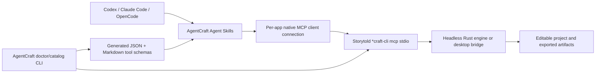

# Architecture — AgentCraft

> **v0.2.0:** Native MCPs are never registered eagerly by the installer. Use [strict on-demand architecture](on-demand.md), including subprocess lifecycle and client-specific invocation. References below to MCP registration describe legacy versions only.

## Data flow

## Surfaces

- **MCP methods:** `initialize`, `tools/list`, `tools/call`, `resources/list`, `resources/templates/list`, `prompts/list`; not all apps offer every optional method.
- **Engine IDs:** some apps expose hundreds of commands via generic MCP `command_list`, `command_run` or equivalents. IDs are **not identical** to MCP tool names, and cannot be synthesized.
- **Agent Skills:** file-based instructions and workflows; don't invoke native executables on their own.
- **Command files:** user-facing `/agentcraft-...` wrapper for Claude/OpenCode. Codex uses `$agentcraft-...` skills.

## Session boundaries

Each normal agent MCP integration keeps a native process alive, preserving the edit session. The `agentcraft call` CLI starts a **new process for every invocation**, so it is appropriate for one-off read-only requests and tests. It cannot coordinate editing multiple commands on an unsaved in-memory project; native MCP sessions or upstream CLI batch mode must be used instead.

## Security

MCP servers can execute operations with the authority of their OS process. Their behavior varies: PhotoCraft/PdfCraft/EffectCraft provide filesystem root scoping options; FilmCraft's documented MCP server does not. Do not assume one shared policy across all thirteen. Run with least privilege and in a dedicated workspace; review file overwrites, scripts and output paths. Bridge modes are loopback or token protected according to upstream; never expose control ports externally. The CLI catalog is read-only unless `--engine` invokes upstream documented command-listing tools. Tool calls with unknown readOnly status require `--allow-write`.

## Source provenance

Official docs in `https://github.com/storytold/<app>/blob/main/docs/mcp.md` except FilmCraft and EffectCraft, which additionally use `docs/agents.md`. The live binary catalog is the authoritative record for the installed release, and the generated `.json` acts as a version-pinned snapshot if retained alongside the binary version.
